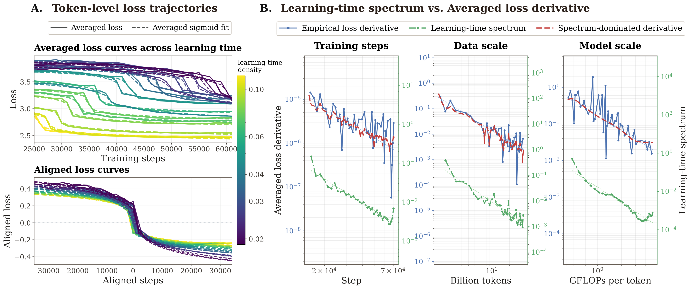
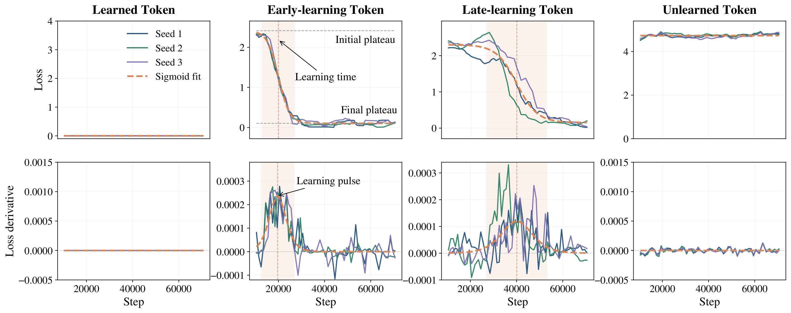

<h1 align="center">Smooth Scaling Laws Hide Stepwise Token Learning</h1>

<p align="center"><strong>Token-level learning events form a learning-time
spectrum that explains the smooth power-law improvement of aggregate
loss.</strong></p>

<p align="center">
  <a href="https://neurips.cc/Conferences/2026"></a>
  <a href="https://openreview.net/pdf?id=THZDVZArRH"></a>
  <a href="https://openreview.net/forum?id=THZDVZArRH"></a>
  <a href="https://huggingface.co/datasets/applewpj/token-learning-spectrum-examples"></a>
  <a href="https://github.com/applewpj/token-learning-spectrum/actions/workflows/ci.yml"></a>
  <a href="LICENSE"></a>
</p>

<p align="center">
  Pingjie Wang &nbsp;·&nbsp; Zechen Hu &nbsp;·&nbsp; Peiru Yang
  &nbsp;·&nbsp; Fu Guo &nbsp;·&nbsp; Debing Zhang
</p>

<p align="center">
  <a href="#cpu-quickstart">Quickstart</a> &nbsp;·&nbsp;
  <a href="#reproducing-the-paper-results">Reproduce the Paper</a> &nbsp;·&nbsp;
  <a href="#using-your-own-loss-matrix">Use Your Own Data</a> &nbsp;·&nbsp;
  <a href="#documentation">Documentation</a> &nbsp;·&nbsp;
  <a href="#citation">Citation</a>
</p>

<hr>

<p align="center">
  
</p>

<p align="center"><em>Individual token losses undergo localized transitions at
different learning times. Their learning-time spectrum closely tracks—and
reconstructs—the macroscopic loss decrease rate along the training-step T,
data-scale D, and model-scale M axes.</em></p>

## TL;DR

- A contextualized token is often learned through a localized, sigmoid-like
  loss transition characterized by its learning time $\tau$.
- The distribution of learning times, $p(\tau)$, is heavy-tailed and largely
  determines the smooth power-law decay of aggregate loss.
- This release provides the analysis package, public loss matrices, configs,
  and acquisition paths needed to study the phenomenon across the `T`, `D`,
  and `M` scaling axes.

## Method at a Glance

Given a token-level loss matrix measured along a scaling axis $a$, the core
package fits each contextualized token with a localized learning event:

```math
\ell_i(a) \approx \ell_i^{\mathrm{post}}
+ \Delta_i \left[1-\sigma\!\left(\lambda_i(a-\tau_i)\right)\right].
```

where $\sigma(z)=1/(1+e^{-z})$. It then estimates the learning-time spectrum
$p(\tau)$, the centered learning pulse $g$, and the spectrum-dominated
reconstruction:

```math
L'(a)
:= -\frac{\mathrm{d}L(a)}{\mathrm{d}a}
\approx \int p(\tau)\,g(a-\tau)\,\mathrm{d}\tau
= (p \ast g)(a).
```



The public release contains:

- `tokenlearning/`: loss loading, sigmoid fitting, filtering, spectrum
  estimation, reconstruction, and plotting.
- `configs/`: analysis configs for the synthetic Mano example and T/D/M paper
  axes.
- `examples/`: metadata for public `losses.npz` matrices hosted on
  HuggingFace.
- `loss_acquisition/`: optional public-safe paths for producing analyzable
  `losses.npz` files from synthetic Mano runs or SGLang checkpoint scoring.

See [Release Scope and Limitations](docs/release.md) for the public/private
boundary and sanitization constraints.

## CPU Quickstart

The smallest example is a compressed 1.5 MB matrix containing loss trajectories
for 10,000 synthetic Mano validation samples across 80 checkpoints. It is
intended to verify the full analysis pipeline on CPU before downloading the
larger real-data matrices.

```bash
git clone https://github.com/applewpj/token-learning-spectrum
cd token-learning-spectrum
pip install -e ".[hf]"
python tools/download_examples.py \
  --repo-id applewpj/token-learning-spectrum-examples \
  --name synthetic_mano_uniform_validation_10k
tokenlearning-run --config configs/synthetic_mano_uniform_validation_10k.yaml
```

Successful execution writes:

```text
runs/synthetic_mano_uniform_validation_10k/
  cache/
  figures/
  metrics.json
```

The main outputs are the raw-vs-sigmoid mean loss, token examples, the
learning-time spectrum, binned learning pulses, and the reconstructed loss
decrease rate. Exact runtime depends on CPU and PyTorch build; the full T/D/M
analyses below are substantially heavier and are configured for CUDA.

## Reproducing the Paper Results

Download all four checksum-verified assets:

```bash
python tools/download_examples.py \
  --repo-id applewpj/token-learning-spectrum-examples \
  --all
```

Then run the axis-specific analyses:

```bash
tokenlearning-run --config configs/step_axis_1m.yaml
tokenlearning-run --config configs/d_axis_1m.yaml
tokenlearning-run --config configs/m_axis_1m.yaml
```

| Paper result | Config | Public input | Scale | Device | Primary outputs |
| --- | --- | --- | ---: | --- | --- |
| Figure 3: training-step axis `T` | [`step_axis_1m.yaml`](configs/step_axis_1m.yaml) | [Step-axis matrix](https://huggingface.co/datasets/applewpj/token-learning-spectrum-examples/blob/main/examples/step_axis_1m/losses.npz) | 1M × 54, 196.7 MB | CUDA | Mean loss, token events, spectrum, pulses, rate reconstruction |
| Figure 4: data-scale axis `D` | [`d_axis_1m.yaml`](configs/d_axis_1m.yaml) | [Data-axis matrix](https://huggingface.co/datasets/applewpj/token-learning-spectrum-examples/blob/main/examples/d_axis_1m/losses.npz) | 1M × 50, 183.0 MB | CUDA | Frontier decomposition and rate reconstruction |
| Figure 5: model-scale axis `M` | [`m_axis_1m.yaml`](configs/m_axis_1m.yaml) | [Model-axis matrix](https://huggingface.co/datasets/applewpj/token-learning-spectrum-examples/blob/main/examples/m_axis_1m/losses.npz) | 1M × 60, 219.3 MB | CUDA | Frontier decomposition and rate reconstruction |
| Appendix: synthetic Mano | [`synthetic_mano_uniform_validation_10k.yaml`](configs/synthetic_mano_uniform_validation_10k.yaml) | [Synthetic matrix](https://huggingface.co/datasets/applewpj/token-learning-spectrum-examples/blob/main/examples/synthetic_mano_uniform_validation_10k/losses.npz) | 10K × 80, 1.5 MB | CPU | Difficulty-conditioned loss, spectrum, pulses, reconstruction |

The complete artifact-to-output mapping, expected files, numerical checks, and
hardware notes are documented in
[`docs/reproduction.md`](docs/reproduction.md). File sizes and SHA256 checksums
are recorded in [`examples/manifest.yaml`](examples/manifest.yaml).

## Input Format

The core input is a `.npz` file:

```text
axis_values: float array [K]
loss_matrix: float array [N, K]
axis_name: optional string array [1]
sample_id: optional array [N]
token_pos: optional array [N]
<metadata_name>: optional array [N]
```

`loss_matrix[i, j]` is the loss of the same contextualized token `i` at axis
point `j`. Extra arrays whose first dimension is `N` are loaded as token
metadata. For example, the synthetic Mano matrix includes `difficulty` and
`question`, which drive grouped loss plots and token-example subplot titles.

## Python API

```python
from tokenlearning.io import load_loss_npz
from tokenlearning.core import fit_token_events, filter_tokens
from tokenlearning.core import estimate_spectrum, compute_binned_learning_pulses

data = load_loss_npz("examples/synthetic_mano_uniform_validation_10k/losses.npz")
fit = fit_token_events(data.axis_values, data.loss_matrix, {"device": "cpu"})
mask = filter_tokens(fit, {"require_positive_delta": True, "min_r2": 0.2})
spectrum = estimate_spectrum(fit.tau[mask], bins=80)
pulses = compute_binned_learning_pulses(data.axis_values, fit, mask)
```

The public fit cache contains:

```text
tau
lambda_
delta
start
end
r2
valid_mask
axis_values
raw_loss_mean
fitted_loss_mean
```

It intentionally does not expose BIC-based fields.

## Using Your Own Loss Matrix

The core package is loss-source agnostic. Acquisition code lives outside
`tokenlearning/`:

- `loss_acquisition/synthetic_mano/`: public synthetic Mano data generation,
  PhysicsLM-style training, checkpoint scoring, and loss export.
- `loss_acquisition/llm_pretraining_sglang/`: SGLang prompt-logprob scoring for
  real LLM pretraining checkpoints supplied by the user.

Synthetic Mano full pipeline:

```bash
python loss_acquisition/synthetic_mano/cli/generate_data.py \
  --config loss_acquisition/synthetic_mano/configs/mano_51m.yaml
python loss_acquisition/synthetic_mano/cli/train.py \
  --config loss_acquisition/synthetic_mano/configs/mano_51m.yaml
python loss_acquisition/synthetic_mano/cli/score_checkpoints.py \
  --config loss_acquisition/synthetic_mano/configs/mano_51m.yaml
```

SGLang public smoke test:

```bash
python loss_acquisition/llm_pretraining_sglang/cli/run_pipeline.py \
  --config loss_acquisition/llm_pretraining_sglang/configs/hf_smollm2_smoke.yaml
```

The SGLang smoke config uses a committed TinyStories validation JSONL and the
public `HuggingFaceTB/SmolLM2-135M` model. For private checkpoints, copy the
config and replace the model/checkpoint paths while keeping private code and
weights outside this repository.

For a minimal custom NPZ, YAML configuration, validation checklist, and output
interpretation, see [`docs/own-data.md`](docs/own-data.md).

## Repository Layout

```text
tokenlearning/                         Core analysis package.
configs/                               YAML analysis configs.
examples/                              HF asset manifest and example docs.
assets/                                README figures from the paper.
docs/                                  Reproduction and user guides.
loss_acquisition/synthetic_mano/       Public synthetic Mano acquisition path.
loss_acquisition/llm_pretraining_sglang/ SGLang checkpoint-loss acquisition.
tools/                                 HF asset and release-check utilities.
tests/                                 Unit tests.
```

## Documentation

- [Paper reproduction and expected outputs](docs/reproduction.md)
- [Analyze your own loss matrix](docs/own-data.md)
- [Release scope, limitations, and maintainer workflow](docs/release.md)
- [Example asset manifest](examples/manifest.yaml)
- [Loss acquisition pipelines](loss_acquisition/README.md)
- [Contributing](CONTRIBUTING.md)

## Citation

```bibtex
@article{wang2026smooth,
  title   = {Smooth Scaling Laws Hide Stepwise Token Learning},
  author  = {Wang, Pingjie and Hu, Zechen and Yang, Peiru and Guo, Fu and Zhang, Debing},
  year    = {2026},
  journal = {Advances in Neural Information Processing Systems},
}
```

## License

This repository is released under the MIT License. See `THIRD_PARTY_NOTICES.md`
for third-party assets and optional runtime dependencies. The released loss
matrices are hosted separately on
[Hugging Face](https://huggingface.co/datasets/applewpj/token-learning-spectrum-examples).
