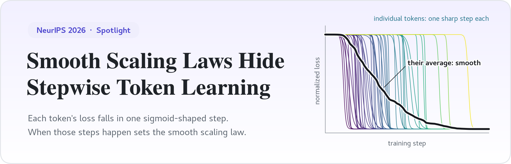
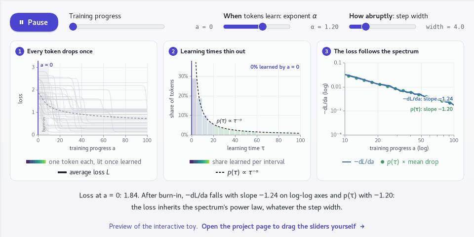

<div align="center">

<a href="https://applewpj.github.io/stepwise-token-learning/"></a>

<p>
  Pingjie Wang<sup>1,2,*,‡</sup>&ensp;
  Zechen Hu<sup>1,*,†</sup>&ensp;
  Peiru Yang<sup>1,3,*,‡</sup>&ensp;
  Fu Guo<sup>1</sup>&ensp;
  Debing Zhang<sup>1,†</sup>
  <br>
  <sup>1</sup>Dots Studio, Xiaohongshu Inc.&ensp;
  <sup>2</sup>Shanghai Jiao Tong University&ensp;
  <sup>3</sup>Tsinghua University
  <br>
  <sub><sup>*</sup>Equal contribution&ensp; <sup>†</sup>Corresponding authors&ensp; <sup>‡</sup>Work done during an internship at Dots Studio, Xiaohongshu Inc.</sub>
</p>

<p>
  <a href="https://applewpj.github.io/stepwise-token-learning/"></a>
  <a href="https://openreview.net/forum?id=THZDVZArRH"></a>
  <a href="https://huggingface.co/datasets/applewpj/stepwise-token-learning"></a>
  <a href="https://colab.research.google.com/github/applewpj/stepwise-token-learning/blob/main/notebooks/quickstart.ipynb"></a>
  <a href="#citation"></a>
</p>

<p>
  <a href="https://github.com/applewpj/stepwise-token-learning/actions/workflows/ci.yml"></a>
  
  <a href="LICENSE"></a>
</p>

</div>

> **Explore it interactively.** The [project page](https://applewpj.github.io/stepwise-token-learning/)
> lets you browse real token trajectories along training steps, data, and model size, watch them add up
> to the loss curve, and play with the mechanism toy shown below. The loss matrices behind every figure
> are on [Hugging Face](https://huggingface.co/datasets/applewpj/stepwise-token-learning), and
> this repository downloads them for you.

## TL;DR

A smooth scaling law is an average over tokens that each learn in a single step. The paper makes four
claims:

1. **Token learning is stepwise.** A token's loss stays on a plateau, drops in one localized transition,
   and plateaus again.
2. **The steps share one pulse shape.** Aligned at their learning times, the loss derivatives of tokens
   learned early and late look the same.
3. **The learning-time spectrum sets the scaling law.** How many tokens are learned at each point of
   the axis drives the validation loss.
4. **The scaling curve can be reshaped.** Reweighting the training data by when tokens become learnable
   makes validation loss fall 11% faster.

Along a scaling axis *a* (training steps *T*, data *D*, or model size *M*), each token *i* is fitted
with one learning event:

$$
\ell_i(a) \approx \ell_i^{\mathrm{post}} + \Delta_i \left[ 1 - \sigma\big( \lambda_i (a - \tau_i) \big) \right],
\qquad \sigma(z) = \frac{1}{1 + e^{-z}}
$$

Here τ is **when** the token is learned, λ **how abruptly**, and Δ **how much** loss it sheds. If every
token's learning pulse (the rate at which its loss drops) has the same shape *g*, the slope of the mean
loss *L* is the learning-time spectrum *p*(τ) smoothed by *g*:

$$
L'(a) := -\frac{\mathrm{d}L}{\mathrm{d}a} \approx \int p(\tau) \thinspace g(a - \tau) \thinspace \mathrm{d}\tau = (p * g)(a),
\qquad p(\tau) = \frac{1}{|\mathcal{I}|} \sum_{i \in \mathcal{I}} \delta(\tau - \tau_i)
$$

The paper tests this on 110+ pre-training runs (290M–6B parameters, up to 300B tokens) and has the
derivations and controls. [`docs/concepts.md`](docs/concepts.md) maps each symbol to the files this
code writes.

<p align="center">
  <a href="https://applewpj.github.io/stepwise-token-learning/#toy"></a>
  <br>
  <sub>The mechanism toy of the <a href="https://applewpj.github.io/stepwise-token-learning/#toy">project page</a>: 2,000 synthetic tokens, each dropping once. Change <i>when</i> tokens learn, and the slope of the loss follows. Click to try it.</sub>
</p>

## Quick start

```bash
git clone https://github.com/applewpj/stepwise-token-learning
cd stepwise-token-learning
pip install -e .                        # Python >= 3.10; a CPU-only PyTorch build is fine
tokenlearning reproduce fig3 --quick    # Figure 3 from 50,000 tokens, about a minute on CPU
```

The last command downloads the training-step loss matrix from Hugging Face (197 MB, checksum
verified), fits one sigmoid per token, draws the panels of Figure 3, and checks four summary numbers
against ours:

```text
result    29,953 of 50,000 fitted tokens pass the event filter
check     tokens kept by the event filter                     59.9%  reference 59.9% +/- 2.0%  ok
check     median learning time of kept tokens                22,924  reference 22,924 +/- 3%  ok
check     R^2, sigmoid-implied vs measured mean loss         0.9876  reference 0.9876 +/- 0.0050  ok
check     corr, spectrum-dominated vs sigmoid-implied L'      0.946  reference 0.946 +/- 0.020  ok
figures   runs/step_axis_1m_quick/figures/
```

No local setup? The
[Colab quickstart](https://colab.research.google.com/github/applewpj/stepwise-token-learning/blob/main/notebooks/quickstart.ipynb)
runs the same steps in the browser.

## Reproduce the paper

| Command | Reproduces | Download |
| --- | --- | ---: |
| `tokenlearning reproduce fig3` | Figure 3, training steps T | 197 MB |
| `tokenlearning reproduce fig4` | Figure 4, data scale D | 183 MB |
| `tokenlearning reproduce fig5` | Figure 5, model scale M | 219 MB |
| `tokenlearning reproduce synthetic` | Appendix, synthetic Mano | 1.5 MB |
| `tokenlearning reproduce all` | all four | 600 MB |

Without flags, a command runs the paper setting: every token, 10,000 epochs. That is meant for a GPU,
which is used automatically when available (`--device cpu` forces the CPU, at hours per figure).
`--quick` draws the same panels from a random 50,000 tokens in about a minute on CPU. Every run:

1. downloads the loss matrix to `examples/<id>/losses.npz`, or verifies the copy already there against
   [`examples/manifest.yaml`](examples/manifest.yaml);
2. fits one sigmoid per token with the settings in [`configs/<id>.yaml`](configs);
3. writes `figures/`, the fitted parameters, `metrics.json`, and the exact config to `runs/<id>/`
   (`runs/<id>_quick/` with `--quick`);
4. checks four summary numbers against [`configs/reference_metrics.yaml`](configs/reference_metrics.yaml)
   and exits with status 1 if any is out of tolerance.

Running a command again reuses the fit when its settings are unchanged, so restyling or re-filtering
takes seconds. [`docs/reproduction.md`](docs/reproduction.md) lists the expected numbers of every
target, which output file is which paper panel, and what the release does not cover.

## Run it on your own losses

All the analysis needs is the loss of the same tokens, in the same contexts, at ordered points along
one axis: checkpoints, data budgets, or model sizes.

```python
import numpy as np

np.savez_compressed(
    "my_losses.npz",
    axis_values=axis_values,   # float [K], strictly increasing
    loss_matrix=loss_matrix,   # float [N, K]; row i is one token at every axis point
    axis_name=np.asarray(["training step"]),
)
```

```bash
cp configs/template.yaml configs/mine.yaml                        # set input.losses_npz and output.dir
tokenlearning run --config configs/mine.yaml --max-tokens 50000   # a subset first
tokenlearning run --config configs/mine.yaml                      # then every token
```

[`docs/own-data.md`](docs/own-data.md) covers the schema, the Python API, and how to choose the
filters. To measure such losses yourself, [`loss_acquisition/`](loss_acquisition/README.md) scores LLM
checkpoints with SGLang or regenerates the synthetic Mano runs end to end.

## Troubleshooting

<details>
<summary><b>The download from Hugging Face is slow or blocked</b></summary>

Use a mirror, or download by hand; the checksum is verified either way.

```bash
HF_ENDPOINT=https://hf-mirror.com tokenlearning download fig3
```

To download manually, get `examples/<id>/losses.npz` from the
[dataset page](https://huggingface.co/datasets/applewpj/stepwise-token-learning/tree/main/examples)
and put it at the same path in your clone. `tokenlearning download --list` shows what is present.
</details>

<details>
<summary><b>I have no GPU</b></summary>

Use `--quick` for every figure, or run the paper setting with `--device cpu` and let it run for a few
hours. A subset spectrum is noisier than the full one, so use the paper setting for quantitative
comparisons. Fewer tokens with `--max-tokens` or fewer epochs with `--epochs` also work; such custom
runs are not checked against the reference.
</details>

<details>
<summary><b>CUDA runs out of memory</b></summary>

Tokens are fitted in chunks of `fit.chunk_size` rows: 500,000 for `fig3` and 1,000,000 for `fig4` and
`fig5`. Lowering it saves memory but is not neutral: the fitting objective includes each chunk's mean
loss curve, so the chunk size is part of the method, and halving it can fail a reference check. If
memory is the problem, prefer `--device cpu`; the paper-setting runs needed 2 to 3 GB of RAM.
</details>

<details>
<summary><b>My numbers differ slightly from the reference</b></summary>

Small differences come from floating-point order on different hardware and are covered by the
tolerances in [`configs/reference_metrics.yaml`](configs/reference_metrics.yaml). If a check fails,
make sure you ran an unmodified config and the default subset seed, and delete `runs/<id>` to rule out
a stale cache from a modified config.
</details>

## Documentation

| Page | What it covers |
| --- | --- |
| [Concepts](docs/concepts.md) | the paper's quantities, the fitted fields, and every output file |
| [Reproduction notes](docs/reproduction.md) | settings, expected numbers, panel map, tolerances, scope |
| [Your own losses](docs/own-data.md) | NPZ schema, configuration, Python API, reading the results |
| [Released data](examples/README.md) | the loss matrices, their sizes and checksums |
| [Loss acquisition](loss_acquisition/README.md) | scoring checkpoints with SGLang, synthetic Mano runs |
| [Contributing](CONTRIBUTING.md) | tests, release checks, the project page and README images |

<details>
<summary><b>Repository layout</b></summary>

```text
tokenlearning/      the package: loading, sigmoid fits, filters, spectra, reconstruction, plots, CLI
configs/            one YAML per paper analysis, and the reference numbers
examples/           manifest (paths, sizes, checksums) of the released loss matrices
notebooks/          Colab quickstart
loss_acquisition/   producing loss matrices: synthetic Mano runs, SGLang scoring of checkpoints
docs/               concepts, reproduction notes, own data, and the project page
assets/             paper figures and the images of this README
tools/              release checks and maintainer utilities
tests/              unit and end-to-end tests
```
</details>

## Citation

```bibtex
@inproceedings{wang2026smooth,
  title     = {Smooth Scaling Laws Hide Stepwise Token Learning},
  author    = {Wang, Pingjie and Hu, Zechen and Yang, Peiru and Guo, Fu and Zhang, Debing},
  booktitle = {Advances in Neural Information Processing Systems},
  year      = {2026},
  url       = {https://openreview.net/forum?id=THZDVZArRH}
}
```

## Acknowledgements and license

This work was supported by Dots Studio, Xiaohongshu Inc. and Shanghai Jiao Tong University. The
synthetic Mano pipeline is adapted from [PhysicsLM4](https://github.com/facebookresearch/PhysicsLM4);
the SGLang smoke test uses [SmolLM2](https://huggingface.co/HuggingFaceTB/SmolLM2-135M) and
[TinyStories](https://huggingface.co/datasets/roneneldan/TinyStories)
(see [`THIRD_PARTY_NOTICES.md`](THIRD_PARTY_NOTICES.md)). Code and the loss matrices are released under
the [MIT License](LICENSE). Questions and bug reports are welcome on the
[issue tracker](https://github.com/applewpj/stepwise-token-learning/issues).
