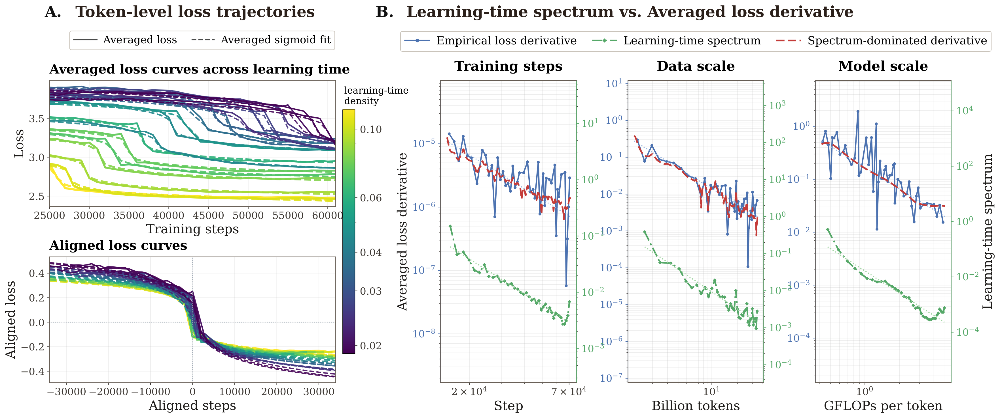

# Token Learning Spectrum: Token-Level Loss Trajectories

<p>
  <a href="https://openreview.net/forum?id=THZDVZArRH"></a>
  <a href="https://openreview.net/pdf?id=THZDVZArRH"></a>
  <a href="https://github.com/applewpj/stepwise-token-learning"></a>
  <a href="https://applewpj.github.io/stepwise-token-learning/"></a>
  <a href="https://colab.research.google.com/github/applewpj/stepwise-token-learning/blob/main/notebooks/quickstart.ipynb"></a>
  <a href="LICENSE"></a>
</p>

Per-token validation-loss trajectories for **one million contextualized tokens**
along each of three scaling axes of LLM pre-training (training steps *T*, data
scale *D*, model scale *M*), plus a synthetic arithmetic example. They are the
inputs to the analysis in
**[Smooth Scaling Laws Hide Stepwise Token Learning](https://openreview.net/forum?id=THZDVZArRH)**
(NeurIPS 2026, Spotlight).

Each row is one contextualized token, and each column is a checkpoint or a run
along the scaling axis. Individual rows drop in localized, sigmoid-like steps at
different *learning times*; the distribution of those times, the learning-time
spectrum, is what shapes the smooth power law of the averaged loss.



## Contents

| Asset | Scaling axis | Rows × points | Axis range | NPZ size | Paper | Viewer config |
| --- | --- | ---: | --- | ---: | --- | --- |
| [`step_axis_1m`](examples/step_axis_1m/losses.npz) | Training steps *T* | 1,000,000 × 54 | 15,000–71,000 steps | 196.7 MB | Figure 3 | `step_axis_1m` (10K-row preview) |
| [`d_axis_1m`](examples/d_axis_1m/losses.npz) | Data scale *D* | 1,000,000 × 50 | 1.196–34.662B tokens | 183.0 MB | Figure 4 | `d_axis_1m` (10K-row preview) |
| [`m_axis_1m`](examples/m_axis_1m/losses.npz) | Model scale *M* | 1,000,000 × 60 | 0.416–4.999 GFLOPs/token | 219.3 MB | Figure 5 | `m_axis_1m` (10K-row preview) |
| [`synthetic_mano_uniform_validation_10k`](examples/synthetic_mano_uniform_validation_10k/losses.npz) | Training steps | 10,000 × 80 | 5,000–400,000 steps | 1.5 MB | Appendix | `synthetic_mano_uniform_validation_10k` (all rows) |

The full matrices are the `losses.npz` files. The Dataset Viewer shows Parquet
previews: a seeded random sample of 10,000 rows from each T/D/M matrix, the
complete synthetic matrix, and an `axes` table with the axis values of every
asset. Byte sizes and SHA256 checksums are listed in
[`manifest.yaml`](manifest.yaml).

## Quick Start

Browse a preview with 🤗 Datasets:

```python
from datasets import load_dataset

repo = "applewpj/token-learning-spectrum-examples"
preview = load_dataset(repo, "step_axis_1m", split="preview")   # columns: row, loss[54]
axes = load_dataset(repo, "axes", split="full")                 # axis values per asset
```

Load a full matrix with NumPy:

```python
import numpy as np
from huggingface_hub import hf_hub_download

path = hf_hub_download(
    repo_id="applewpj/token-learning-spectrum-examples",
    repo_type="dataset",
    filename="examples/step_axis_1m/losses.npz",
)
with np.load(path, allow_pickle=False) as data:
    steps = data["axis_values"]        # (54,) training steps
    losses = data["loss_matrix"]       # (1000000, 54) float32, one row per token

mean_loss = losses.mean(axis=0)        # the aggregate validation-loss curve
```

Reproduce the paper figures from these files with the
[analysis code](https://github.com/applewpj/stepwise-token-learning). Each
command downloads the matrix it needs, verifies its checksum, fits it, and
checks the result against reference numbers:

```bash
git clone https://github.com/applewpj/stepwise-token-learning
cd stepwise-token-learning
pip install -e .
tokenlearning reproduce fig3 --quick   # Figure 3 from 50,000 tokens, about a minute on CPU
tokenlearning reproduce all            # Figures 3-5 and the appendix at the paper setting
```

The [Colab quickstart](https://colab.research.google.com/github/applewpj/stepwise-token-learning/blob/main/notebooks/quickstart.ipynb)
runs the same pipeline in the browser.

## Data Structure

Each `losses.npz` contains:

```text
axis_values: float64 [K]     ordered positions along the scaling axis
loss_matrix: float32 [N, K]  loss of token row i at axis point j
axis_name:   string  [1]     e.g. "training step"
```

Rows are aligned: `loss_matrix[i, j]` is the same contextualized token at every
axis point `j`, which is what makes token-level trajectories meaningful. The
synthetic matrix adds per-row metadata: `sample_id`, `token_pos`, `difficulty`,
`seed`, and `question` (the arithmetic expression).

The Parquet previews have one row per token with columns `row` (index into the
full `loss_matrix`), any per-row metadata, and `loss` (the trajectory as a list
of `K` floats). The `axes` config has one row per asset with `asset`,
`axis_name`, `n_points`, `n_tokens`, `preview_rows`, and `axis_values`.

## Provenance

| Asset | How it was produced |
| --- | --- |
| `step_axis_1m` | A 1.5B dense model trained on 300B tokens of a mixed corpus (Chinese, English, mathematics, reasoning, books, papers, code); 54 checkpoints. |
| `d_axis_1m` | A 290M MoE model; a 50-run sweep over training budgets from 1B to 35B tokens, each run with a complete warmup-constant-decay schedule, used to construct the data-scale frontier. |
| `m_axis_1m` | A 60-run sweep of model variants from 0.42 to 5.00 GFLOPs/token (≈400M–6B parameters), each trained on 10B tokens and tuned toward a near-optimal model-scale frontier. |
| `synthetic_mano_uniform_validation_10k` | The public synthetic arithmetic (Mano) pipeline adapted from [PhysicsLM4](https://github.com/facebookresearch/PhysicsLM4); 10,000 validation samples scored at 80 checkpoints. |

The T/D/M losses are measured on held-out validation tokens; for the step axis,
the validation set is sampled from the same distribution as the training
corpus. The matrices are sanitized analysis artifacts: they keep aligned token
losses and axis values only, and do not include model architectures, weights,
tokenizers, validation text, training-data composition, experiment registries,
or checkpoint paths.

## Uses and Limitations

Suited for reproducing the paper's analysis, testing alternative learning-time
estimators or curve-fitting methods, and studying token-level learning dynamics
along scaling axes.

- Rows of the T/D/M matrices cannot be mapped back to token strings or text.
- These are loss measurements, not a language-model training corpus.
- Per-token trajectories are noisy; the paper's sigmoid fits describe the
  dominant transition, not every fluctuation.

## Citation

```bibtex
@inproceedings{wang2026smooth,
  title     = {Smooth Scaling Laws Hide Stepwise Token Learning},
  author    = {Wang, Pingjie and Hu, Zechen and Yang, Peiru and Guo, Fu and Zhang, Debing},
  booktitle = {Advances in Neural Information Processing Systems},
  year      = {2026},
  url       = {https://openreview.net/forum?id=THZDVZArRH}
}
```

## License and Contact

The matrices are released under the MIT License. Questions and issues are
welcome on the
[GitHub issue tracker](https://github.com/applewpj/stepwise-token-learning/issues).
